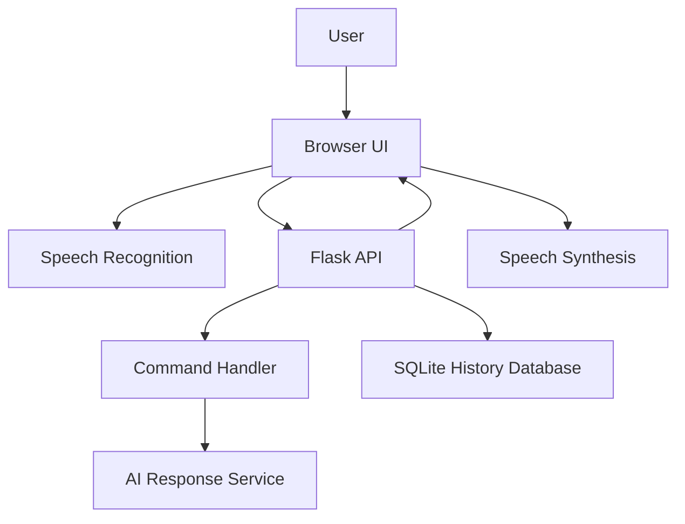

# Nova Voice Assistant

> A polished browser-based Python voice assistant that listens, transcribes, responds with AI-powered answers, speaks replies aloud, and stores conversation history locally.


## Table of Contents

- [Overview](#overview)
- [Features](#features)
- [Tech Stack](#tech-stack)
- [Architecture](#architecture)
- [Folder Structure](#folder-structure)
- [Installation](#installation)
- [Environment Variables](#environment-variables)
- [Running the App](#running-the-app)
- [API Documentation](#api-documentation)
- [Screenshots](#screenshots)
- [Security](#security)
- [Testing](#testing)
- [Roadmap](#roadmap)
- [Contributing](#contributing)
- [License](#license)
- [Author](#author)
- [FAQ](#faq)

## Overview

Nova Voice Assistant is a portfolio-ready Python web application that brings a conversational assistant experience into the browser. Users can speak or type a question, review the captured text, send it to the assistant, hear the answer spoken aloud, and revisit previous conversations from a persistent history sidebar.

The project is designed for learners and developers who want to understand how voice input, browser speech synthesis, Flask APIs, local persistence, and AI responses can work together in a practical assistant-style application.

## Features

| Feature | Description |
| --- | --- |
| Voice Input | Uses browser speech recognition to capture spoken questions. |
| Manual Review Before Send | Captured speech is written into the input box first, so users can edit before sending. |
| Spoken Answers | Uses browser speech synthesis to read assistant responses aloud. |
| AI Responses | Sends general questions to an AI model through a secure environment variable. |
| Built-in Commands | Supports opening Google, YouTube, GitHub, Gmail, search, play, date, and time commands. |
| Persistent History | Saves conversations locally in SQLite. |
| Date Grouping | Groups history by day, month, or year. |
| Export History | Downloads saved conversations as CSV. |
| New Conversation Sessions | Keeps separate conversations organized by session. |
| Responsive UI | Works across desktop and smaller screens. |
| Theme Toggle | Includes polished light and dark themes. |
| Delete Confirmation | Uses a custom confirmation modal before clearing history. |

## Tech Stack

| Layer | Technology |
| --- | --- |
| Frontend | HTML, CSS, JavaScript |
| Voice Input | Web Speech API |
| Voice Output | SpeechSynthesis API |
| Backend | Python, Flask |
| Database | SQLite |
| AI Integration | Google GenAI SDK |
| Package Management | pip, virtualenv |

## Architecture



## Folder Structure

```text
Nova Voice Assistant/
├── app.py
├── requirements.txt
├── README.md
├── LICENSE
├── CONTRIBUTING.md
├── CODE_OF_CONDUCT.md
├── SECURITY.md
├── CHANGELOG.md
├── .env.example
├── .gitignore
└── templates/
    └── index.html
```

Local-only files such as `.venv/`, `jarvis_history.db`, `__pycache__/`, and ZIP exports are intentionally ignored by Git.

## Installation

Clone the repository:

```bash
git clone https://github.com/your-username/nova-voice-assistant.git
cd nova-voice-assistant
```

Create and activate a virtual environment:

```bash
python -m venv .venv
```

Windows PowerShell:

```powershell
& ".\.venv\Scripts\Activate.ps1"
```

macOS/Linux:

```bash
source .venv/bin/activate
```

Install dependencies:

```bash
pip install -r requirements.txt
```

## Environment Variables

Create a local environment variable named `GEMINI_API_KEY`.

Windows PowerShell:

```powershell
$env:GEMINI_API_KEY="your-api-key-here"
```

macOS/Linux:

```bash
export GEMINI_API_KEY="your-api-key-here"
```

Never commit real API keys to GitHub.

## Running the App

Start the Flask server:

```bash
python app.py
```

Open the app in Chrome or Edge:

```text
http://127.0.0.1:5000/
```

Check server health:

```text
http://127.0.0.1:5000/health
```

Expected response when the API key is configured:

```json
{
  "ok": true,
  "api_key": true
}
```

## API Documentation

### `GET /`

Renders the main Nova assistant interface.

### `POST /ask`

Sends a user command or question to the assistant.

Request:

```json
{
  "command": "What is GitHub?",
  "session_id": "optional-session-id"
}
```

Response:

```json
{
  "answer": "GitHub is a platform for hosting and collaborating on Git repositories.",
  "session_id": "session-id"
}
```

### `GET /history`

Returns grouped conversation summaries.

### `GET /history/<session_id>`

Returns all messages for one conversation session.

### `DELETE /history`

Deletes all saved local conversation history.

### `GET /history/export`

Exports all saved conversations as a CSV file.

### `GET /health`

Returns app status and whether the API key is available to the running process.

## Screenshots

Add screenshots after publishing the project:

- Home page
- Voice listening state
- Conversation history sidebar
- Light theme
- Dark theme
- Mobile layout

## Security

- API keys are read from environment variables only.
- `.env` files and local databases are excluded from Git.
- History is stored locally in SQLite.
- The app does not expose user secrets in the frontend.
- Users must explicitly allow microphone access in the browser.

## Testing

Manual checks recommended before deployment:

- Start the Flask server successfully.
- Verify `/health` returns `ok: true`.
- Test typed questions.
- Test voice input in Chrome or Edge.
- Confirm spoken responses work.
- Confirm history is saved, loaded, exported, and deleted.
- Test light/dark theme switching.
- Test sidebar behavior on smaller screens.

## Roadmap

- Add user-selectable speech language.
- Add local settings page.
- Add automated backend tests.
- Add Docker support.
- Add GitHub Actions CI.
- Add optional cloud deployment guide.
- Add microphone troubleshooting panel.
- Add conversation rename and pin features.

## Future Improvements

- Add rate limiting for production deployments.
- Add streaming responses.
- Add offline command handling.
- Add richer keyboard shortcuts.
- Add voice activity visualization.
- Add import/export backup restore.

## Contributing

Contributions are welcome. Please read [CONTRIBUTING.md](CONTRIBUTING.md) before opening a pull request.

## License

This project is licensed under the MIT License. See [LICENSE](LICENSE) for details.

## Author

Built as a portfolio project by:

- Name: Pooja
- GitHub: `https://github.com/Pooja24100`
- LinkedIn: Add your LinkedIn profile
- Portfolio: Add your portfolio website
- Email: Add your professional email

## FAQ

### 1. Why should I use Chrome or Edge?

Browser speech recognition works most reliably in Chrome and Edge.

### 2. Why does microphone access fail?

The browser may be blocking microphone permission. Allow microphone access from the address bar site settings.

### 3. Why does `/health` show `api_key: false`?

The Flask app was started from a terminal where `GEMINI_API_KEY` was not set.

### 4. Is history stored forever?

Yes. History remains in the local SQLite database until you delete it.

### 5. Is the database committed to GitHub?

No. `jarvis_history.db` is ignored because it is local user data.

### 6. Can I type instead of speaking?

Yes. The input box supports typed messages.

### 7. Does Nova send automatically after listening?

No. Speech is written into the input box first. You review it and click Send.

### 8. Can Nova open websites?

Yes. It supports commands such as “open Google,” “open YouTube,” and “open GitHub.”

### 9. Can I export history?

Yes. The app provides a CSV export endpoint.

### 10. Can this be deployed online?

Yes, but production deployment should include secure environment variables, HTTPS, and rate limiting.

## Conclusion

Nova Voice Assistant demonstrates a complete assistant-style workflow using Python, Flask, browser speech APIs, local persistence, and a polished responsive interface. It is a strong foundation for learning, portfolio presentation, and future production-ready assistant features.
